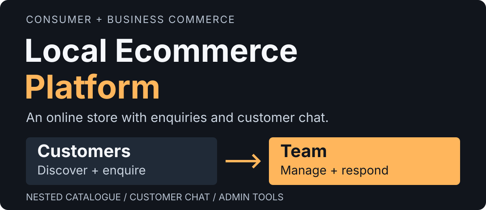

# Local Ecommerce Platform

An ecommerce storefront and admin system for **bringing a local store online**, serving individual and business customers through a structured catalogue, product enquiries and two-way customer chat.

## Project Summary

The wider vision was a local alternative to large online marketplaces, covering many product categories and business buying needs. The work brings together a customer storefront and a separate administration application, with the tools needed to browse products, collect requirements and continue the sales conversation.

**The purchase flow was enquiry-based by request.** Customers select products and quantities, send the cart as an enquiry, then exchange messages with the store. Staff can review the requested items and customer details, reply from the admin panel and track the enquiry status. This lets the store discuss availability, requirements and pricing before arranging the sale.

The platform also includes individual and company accounts, company-name and GSTIN fields, saved addresses, wishlist tools, a three-level catalogue and store-presentation controls. Custom printing is an additional service with artwork uploads and specifications connected to the same enquiry system.

<strong>Open contents: jump to a section</strong>

- [For an Offline Store Going Online](#for-an-offline-store-going-online)
- [What Was Built](#what-was-built)
- [Product Screens](#product-screens)
- [From Product Discovery to Follow-Up](#from-product-discovery-to-follow-up)
- [Customer Chat and Enquiry Management](#customer-chat-and-enquiry-management)
- [Engineering Work Behind the Screens](#engineering-work-behind-the-screens)
- [Engineering at a Glance](#engineering-at-a-glance)
- [Building an Online Store for a Local Business](#building-an-online-store-for-a-local-business)

## For an Offline Store Going Online

A store owner needs customers to find products and a practical way to handle the requests that follow. This project connects those two sides.

| What the store needs | How the platform supports it |
|---|---|
| Show a varied product range online | Product pages, images, search, filtering and category → subcategory → group navigation |
| Discuss an order before confirming it | Cart-based enquiries carrying the selected products and quantities |
| Answer customers from the store’s own panel | A conversation thread for each enquiry, with customer and administrator replies |
| Serve individuals and businesses | Individual/company registration, company name, GSTIN validation and saved addresses |
| Maintain the online shop | Product prices, stock fields, availability, featured/popular flags, banners and announcements |
| Offer services alongside standard products | Custom-print specifications and artwork uploads linked to customer enquiries |

The same approach is relevant to retailers and suppliers whose sales need a conversation before confirmation, including multi-item business requirements and custom work.

## What Was Built

| Customer storefront | Administration workspace |
|---|---|
| Browse categories, subcategories and product groups; search, filter and sort listings | Maintain the catalogue hierarchy, product details and assignments |
| Save products to a wishlist and adjust cart quantities | Review requested products, quantities and customer information |
| Register as an individual or company; maintain business details and saved addresses | Open customer details alongside enquiries and service requests |
| Open enquiry history, read the conversation and send follow-up messages | Open the enquiry chat, reply, filter requests and update status |
| Configure custom printing as an additional service | Review artwork, print specifications and related requests |
| Browse featured products and store announcements | Manage banners, promotional text, product prices and stock fields |

## Product Screens

Select a screenshot to open it at full size.

The gallery shows product discovery and selection alongside the tools used to maintain the catalogue and handle customer enquiries.

<table>
<tr><th width="50%">Customer: product browsing</th><th width="50%">Team: catalogue management</th></tr>
<tr><td></td><td></td></tr>
<tr><th width="50%">Customer: product details</th><th width="50%">Team: enquiry follow-up</th></tr>
<tr><td></td><td></td></tr>
</table>

### Customer and Admin Phone Views

<table>
<tr><th width="50%">Storefront</th><th width="50%">Product catalogue</th></tr>
<tr><td></td><td></td></tr>
<tr><th width="50%">Cart and quantities</th><th width="50%">Administration dashboard</th></tr>
<tr><td></td><td></td></tr>
</table>

[Explore the catalogue, customer services and desktop/phone admin screens →](docs/product-tour.md)

## From Product Discovery to Follow-Up

1. **Find the right products.** Browse the catalogue through categories, subcategories and groups, then narrow the selection with search, filters and sorting.
2. **Build a requirement.** Review product details, save items or add them to the cart with the required quantities. Customer profiles hold business details and saved addresses where needed.
3. **Start a conversation.** Submit a product enquiry so the team can review the selected items and respond. Custom-print requests additionally carry artwork and print specifications.
4. **Manage the follow-up.** Staff open the enquiry chat, inspect the selected items and customer context, then send a reply. Customers read and answer through enquiry history, while staff track pending, replied, resolved or closed requests.

## Customer Chat and Enquiry Management

Each enquiry has its own conversation. The requested products and quantities remain attached to it, so the store can discuss the customer’s selection without rebuilding the context from separate messages.

- **On the customer side:** open enquiry history, expand a request, see its items and messages, and send a follow-up reply. Regular product enquiries and custom-print requests can be filtered separately.
- **On the admin side:** search enquiries by customer details or message, filter by status, inspect the selected items and open a chat window. Staff can read timestamped customer/admin messages, send replies and change the request status.
- **Across the workflow:** replies are saved against the enquiry. A customer follow-up returns the request to pending; an administrator reply marks it replied. The storefront also includes reply-count and enquiry-notification handling.

For example, a customer can ask about several products in the quantities they need, then clarify the requirement in the same thread. The store’s response stays alongside that request. Custom-print conversations additionally carry the artwork and specifications.

## Engineering Work Behind the Screens

| Challenge | What was implemented |
|---|---|
| A product range outgrows a flat list | Category, subcategory and group relationships across admin forms, storefront navigation, filters and breadcrumbs |
| A request needs several exchanges | Persistent enquiry replies, separate customer/admin message views, timestamps and status transitions |
| Category changes affect existing products | Dependency-aware deletion, with reassignment and force-delete handling |
| Consumer and business accounts need different information | Conditional company fields and GSTIN format validation, plus customer-detail views for staff |
| Customers use more than one address | Separate address records with add/edit/delete and default-address selection |
| Staff need to update the shop’s presentation | Admin controls for banners, promotional text, announcement visibility and product merchandising |
| Account recovery arrives in different browser states | Email-callback and session handling, with loading, success and error feedback |

## Engineering at a Glance

| Area | Implementation |
|---|---|
| Interfaces | Independently built React/Vite storefront and admin applications |
| Catalogue | Category → subcategory → group hierarchy, URL-based filters and breadcrumbs |
| Data | Supabase/PostgreSQL for relational catalogue, customer, address and enquiry records |
| Artwork | File-storage integration linked to custom-print requests |
| Conversations | Enquiries, linked product items and persistent customer/admin reply records |
| Workflows | Individual/company registration, saved addresses, account recovery and enquiry status handling |
| Reporting | PostgreSQL RPC aggregation feeding dashboard views |

The [engineering guide](docs/engineering.md) walks through the data relationships and failure cases behind these features. Screenshots use illustrative catalogue and account data. Application source and internal configuration are maintained separately.

## Building an Online Store for a Local Business

This project demonstrates the work involved in connecting a customer-facing store with the tools staff use behind it. A similar store can be planned around the business’s product range, customer types and sales process, including whether a purchase starts with an enquiry or needs a different checkout flow.

[**Discuss a store website or business workflow →**](https://github.com/manudev0004)
