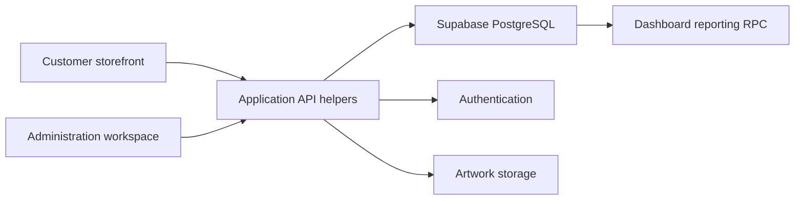

# Architecture and Engineering Decisions

[Overview](../README.md) · [Product tour](product-tour.md)

## Technical Summary

Two independently built React/Vite applications share a Supabase-backed data model: a storefront for customer actions and an administration workspace for catalogue maintenance and enquiry follow-up. The work connects interface state with relational records, artwork storage and reporting.

## Contents

- [System Boundaries](#system-boundaries)
- [Custom-Print Request Flow](#custom-print-request-flow)
- [Catalogue Hierarchy and Deletion](#catalogue-hierarchy-and-deletion)
- [Customer Addresses](#customer-addresses)
- [Recovery and Session Handling](#recovery-and-session-handling)
- [Dashboard Aggregation](#dashboard-aggregation)
- [Mobile Navigation](#mobile-navigation)

## System Boundaries

The API helpers translate screen actions into database and storage operations. Catalogue relationships, saved addresses and linked enquiry records live in the data layer. Authentication and database access policies have responsibilities beyond the browser's route guards.

## Custom-Print Request Flow

A submission combines several pieces of work:

1. Upload the artwork and obtain its storage reference.
2. Create a print request containing product type, size, colour, quantity, position and estimated price.
3. Create the corresponding enquiry.
4. Link the print request to that enquiry.
5. Add the requested item/specification details for review and follow-up.

The relationship between the print request and enquiry lets a staff member see the requested work alongside the conversation. It also means the write sequence needs explicit failure handling. The implementation includes compensating cleanup for some intermediate failures; these browser-driven operations are not an atomic database transaction. A server-side transaction and storage-cleanup policy are useful next steps for stronger consistency.

## Catalogue Hierarchy and Deletion

The catalogue evolved from categories to a category/subcategory/group hierarchy. That change reaches across foreign-key relationships, administration forms, storefront menus, query parameters, filtering and breadcrumbs.

The URL carries browsing context so a user can move between listings and product details without losing the selected branch of the catalogue. The administration interface exposes the same hierarchy for maintaining product assignments.

Deletion requires a decision about dependent products. The work includes reassignment and force-delete handling so category maintenance can account for references instead of treating a category as an isolated label.

## Customer Addresses

Addresses were moved into their own records rather than remaining a single set of fields on the customer profile. The model supports several saved locations and a default-address choice, with database trigger and row-level policy work in the implementation history.

This gives the customer forms and administration screens a consistent structure to read and update. Default selection is a data-consistency concern as well as a checkbox in the interface, particularly when several updates happen close together.

## Recovery and Session Handling

The password-recovery flow handles arrival from an email callback and the session state already present in the browser. Loading, success and error feedback guide the user through updating a password and returning to login.

A recovery session, an expired callback and a normal signed-in session need different handling. The interface work makes those transitions explicit; authentication configuration and server-side authorisation remain separate system boundaries.

## Dashboard Aggregation

The dashboard retrieves a combined result through `get_dashboard_data`, a PostgreSQL RPC. The mapped result covers user/customer counts, products, categories, custom-print activity, enquiries and chart series.

This keeps aggregation outside the chart components and brings enquiry progress into the same reporting workspace as store maintenance. The time controls request the selected reporting period. Displayed screenshot totals are illustrative records.

## Mobile Navigation

The interface work includes iterations to the compact header, category menu, search and bottom navigation. These controls provide access to browsing and account actions without requiring the desktop menu arrangement.

The gallery retains normal phone viewport proportions, making it possible to inspect what is visible at one time. Product and admin views use the same varied sample catalogue.

## What the Implementation Shows

The most involved work is the coordination between screens and data: maintaining catalogue relationships, connecting artwork to an enquiry, supporting several addresses and handling account/session transitions. The project presents those application workflows together with the administrative tools needed to manage them.
