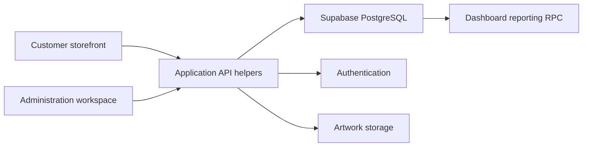

# Architecture and Engineering Decisions

[Overview](../README.md) · [Product tour](product-tour.md)

## Technical Summary

Two independently built React/Vite applications share a Supabase-backed data model: a storefront for customer actions and an administration workspace for catalogue maintenance and enquiry follow-up. The local consumer and B2B commerce vision shaped the catalogue and customer workflows. The implementation connects multi-level product navigation, customer and business information, relational enquiry records and reporting; custom printing adds a service-specific extension.

## Contents

- [System Boundaries](#system-boundaries)
- [Enquiry-Based Sales and Customer Chat](#enquiry-based-sales-and-customer-chat)
- [Catalogue Hierarchy and Deletion](#catalogue-hierarchy-and-deletion)
- [Customer and Business Information](#customer-and-business-information)
- [Custom-Print Request Flow](#custom-print-request-flow)
- [Store Maintenance and Merchandising](#store-maintenance-and-merchandising)
- [Recovery and Session Handling](#recovery-and-session-handling)
- [Dashboard Aggregation](#dashboard-aggregation)
- [Mobile Navigation](#mobile-navigation)

## System Boundaries

The API helpers translate screen actions into database and storage operations. Catalogue relationships, saved addresses and linked enquiry records live in the data layer. Authentication and database access policies have responsibilities beyond the browser's route guards.

## Enquiry-Based Sales and Customer Chat

The requested sales process sends the cart to the store as an enquiry. The customer selects products and quantities, and staff discuss the requirement through the admin panel. Payment-gateway integration was outside that requested flow.

### Records and Interface Behaviour

| Record | Responsibility |
|---|---|
| `enquiries` | Customer reference, contact details, initial message, request type and status |
| `enquiry_items` | Product references with saved product names, prices, quantities and optional customisation |
| `enquiry_replies` | Messages linked to an enquiry, with an administrator/customer flag and creation timestamp |

The customer history screen retrieves the customer’s enquiries with linked items and replies, shows reply counts and allows a follow-up message. Regular and custom-print enquiries can be filtered separately. The admin workspace retrieves the conversation, sorts messages by creation time and presents customer/admin replies on opposite sides of the chat window. Search, status filters, pagination and customer-detail views support staff review.

Reply records make the conversation persistent across visits. Customer replies set the enquiry to `pending`; administrator replies set it to `replied` and update the admin-reply flag. Staff can also select `resolved` or `closed`.

### Implementation Decisions

- Keeping items separate from replies preserves the original product selection as the conversation grows.
- The reply table has an enquiry foreign key with cascade deletion, plus indexes on the enquiry ID and creation timestamp in the historical schema.
- The shared enquiry concept supports standard products and custom-print services while their additional specifications remain separate.
- The interface loads conversations on screen entry or opening a chat and refreshes relevant state after sending. It is a persisted request/reply interface; no WebSocket or Supabase Realtime subscription was found in the reviewed chat paths.

The current notification logic uses enquiry-level statuses. Viewing customer history marks replied enquiries resolved, so that state also serves as a read indicator. Separating message-read tracking from business resolution would make those meanings clearer. Reply insertion and status updates are separate operations, which also need explicit error handling if stronger consistency is required.

## Catalogue Hierarchy and Deletion

The catalogue evolved from categories to a category/subcategory/group hierarchy. That change reaches across foreign-key relationships, administration forms, storefront menus, query parameters, filtering and breadcrumbs.

The URL carries browsing context so a user can move between listings and product details without losing the selected branch of the catalogue. The administration interface exposes the same hierarchy for maintaining product assignments.

Deletion requires a decision about dependent products. The work includes reassignment and force-delete handling so category maintenance can account for references instead of treating a category as an isolated label.

## Customer and Business Information

Registration distinguishes individual and company accounts. Company signup collects a company name and checks the GSTIN against a 15-character format before submission. This is format validation, not verification against a tax registry. Customer-detail modals expose account and address context to staff reviewing enquiries and print requests. Product quantities and enquiry conversations support the requirement-gathering side of business buying.

Addresses were moved into their own records rather than remaining a single set of fields on the customer profile. The model supports several saved locations and a default-address choice, with database trigger and row-level policy work in the implementation history.

This gives the customer forms and administration screens a consistent structure to read and update. Default selection is a data-consistency concern as well as a checkbox in the interface, particularly when several updates happen close together.

## Custom-Print Request Flow

Custom printing is one service within the wider commerce application. Its submission combines several pieces of work:

1. Upload the artwork and obtain its storage reference.
2. Create a print request containing product type, size, colour, quantity, position and estimated price.
3. Create the corresponding enquiry.
4. Link the print request to that enquiry.
5. Add the requested item/specification details for review and follow-up.

The relationship between the print request and enquiry lets a staff member see the requested work alongside the conversation. It also means the write sequence needs explicit failure handling. The implementation includes compensating cleanup for some intermediate failures; these browser-driven operations are not an atomic database transaction. A server-side transaction and storage-cleanup policy are useful next steps for stronger consistency.

## Store Maintenance and Merchandising

The active product-management screen combines category assignments with product descriptions, images, prices, stock quantity, availability and featured/popular flags. Price-editing controls link the current price, previous price and discount fields. These are catalogue-maintenance tools, rather than evidence of an inventory-reservation or fulfilment system.

Separate administration pages manage banners and promotional settings. The storefront reads those settings through context providers for presentation elements such as announcements and promotional text. This gives the store controls for routine presentation changes alongside product maintenance.

## Recovery and Session Handling

The password-recovery flow handles arrival from an email callback and the session state already present in the browser. Loading, success and error feedback guide the user through updating a password and returning to login.

A recovery session, an expired callback and a normal signed-in session need different handling. The interface work makes those transitions explicit; authentication configuration and server-side authorisation remain separate system boundaries.

## Dashboard Aggregation

The dashboard retrieves a combined result through `get_dashboard_data`, a PostgreSQL RPC. The mapped result covers user/customer counts, products, categories, custom-print activity, enquiries and chart series.

This keeps aggregation outside the chart components and brings enquiry progress into the same reporting workspace as store maintenance. The time controls request the selected reporting period. Displayed screenshot totals are illustrative records.

## Mobile Navigation

The interface work includes iterations to the compact header, category menu, search and bottom navigation. These controls provide access to browsing and account actions without requiring the desktop menu arrangement.

The gallery retains normal phone viewport proportions, making it possible to inspect what is visible at one time. Product and admin views use the same varied sample catalogue.

## What the Implementation Shows

The most involved work is the coordination between screens and data: maintaining a multi-level catalogue, carrying customer and business context into enquiries, supporting several addresses, connecting artwork to a service request and handling account/session transitions. The project presents those application workflows together with the administrative tools needed to manage them.
