# Product Tour

[Overview](../README.md) · [Engineering](engineering.md)

## The Customer and Staff Journey

A standard product enquiry starts with browsing and a cart. A custom-print enquiry also needs artwork, printing choices and a quantity. The project gives both journeys a place in the storefront, then brings the resulting requests into the administration workspace.

For a customer, the useful outcome is a request with the relevant details attached. For the staff member, it is a conversation that can be reviewed, answered and tracked alongside catalogue work.

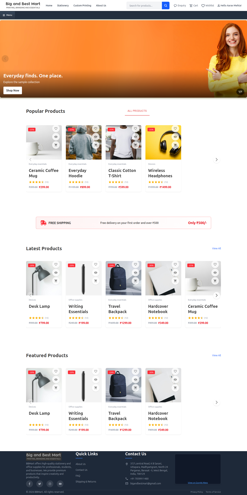

## Contents

- [Customer Experience](#customer-experience)
- [Catalogue and Product Details](#catalogue-and-product-details)
- [Cart and Custom Printing](#cart-and-custom-printing)
- [Phone Views](#phone-views)
- [Administration Workspace](#administration-workspace)

## Customer Experience

| Area | What the application supports |
|---|---|
| Product discovery | Search, category/subcategory/group navigation, filters, sorting and product details |
| Saved selections | Wishlist and cart, with quantity changes and item removal |
| Account tools | Profile information, multiple saved addresses and account recovery flows |
| Product enquiries | Send selected cart items and quantities to the administration team |
| Custom printing | Choose a product, size, colour, quantity and print position; upload artwork and submit a request |
| Follow-up | Enquiry history, request status and replies |
| Smaller screens | Compact navigation, mobile menus and layouts for browsing and account access |

### Catalogue and Product Details

<table>
<tr><th width="50%">Product catalogue</th><th width="50%">Product details</th></tr>
<tr><td>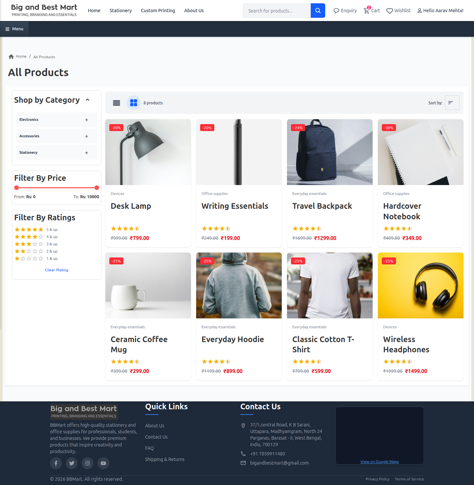</td><td>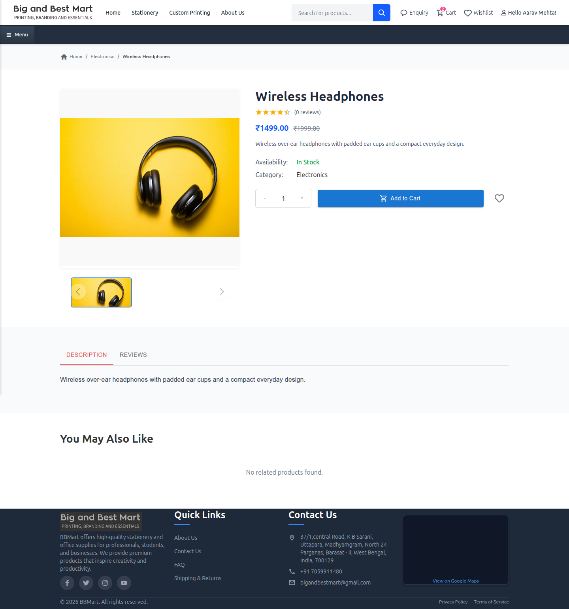</td></tr>
</table>

The catalogue uses categories, subcategories and groups. Selection state travels in the URL, allowing navigation and breadcrumbs to retain the browsing context. Product cards bring the image, category, price and quick actions together; the detail view provides a closer look before saving or enquiring.

### Cart and Custom Printing

<table>
<tr><th width="50%">Cart and enquiry</th><th width="50%">Custom-print request</th></tr>
<tr><td>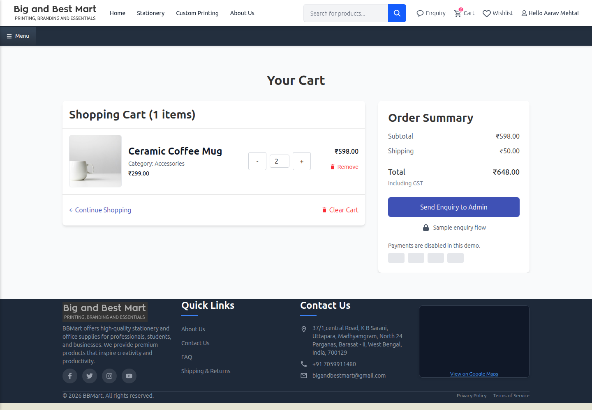</td><td>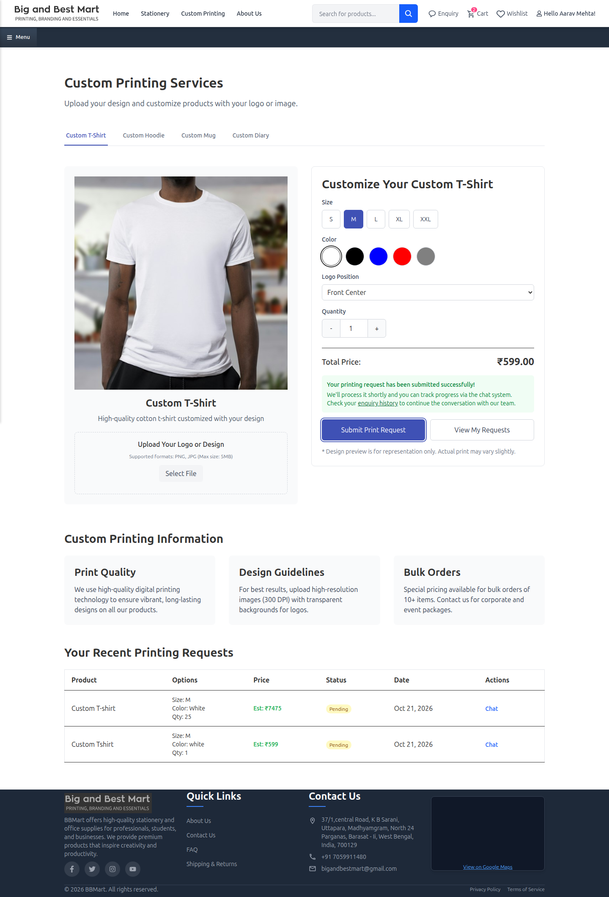</td></tr>
</table>

The cart collects selected items into an enquiry for the team to follow up. Custom printing has a separate flow because the customer needs to specify artwork and printing choices before the team can respond. The form calculates an estimated price and connects the print request to an enquiry thread.

### Phone Views

<table>
<tr><th width="50%">Storefront</th><th width="50%">Catalogue</th></tr>
<tr><td>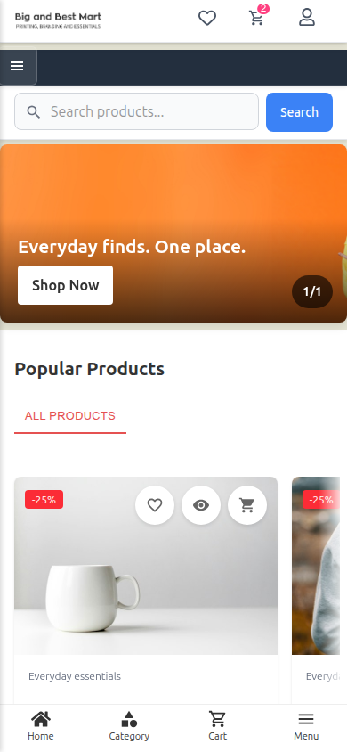</td><td>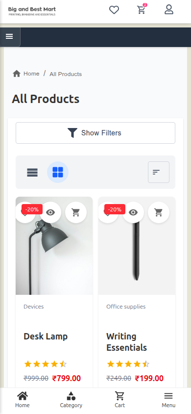</td></tr>
<tr><th>Cart</th><th>Custom printing</th></tr>
<tr><td>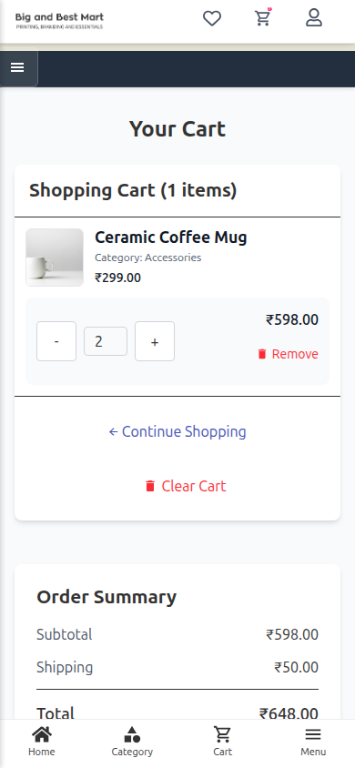</td><td>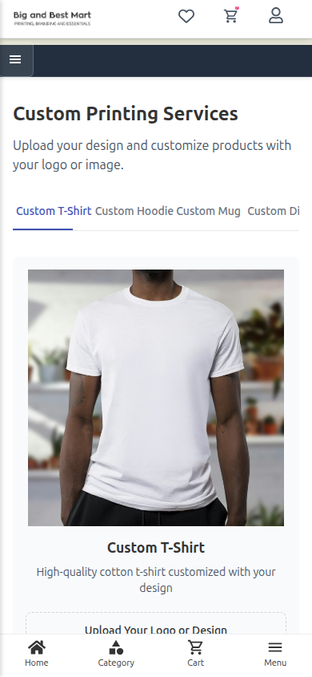</td></tr>
</table>

## Administration Workspace

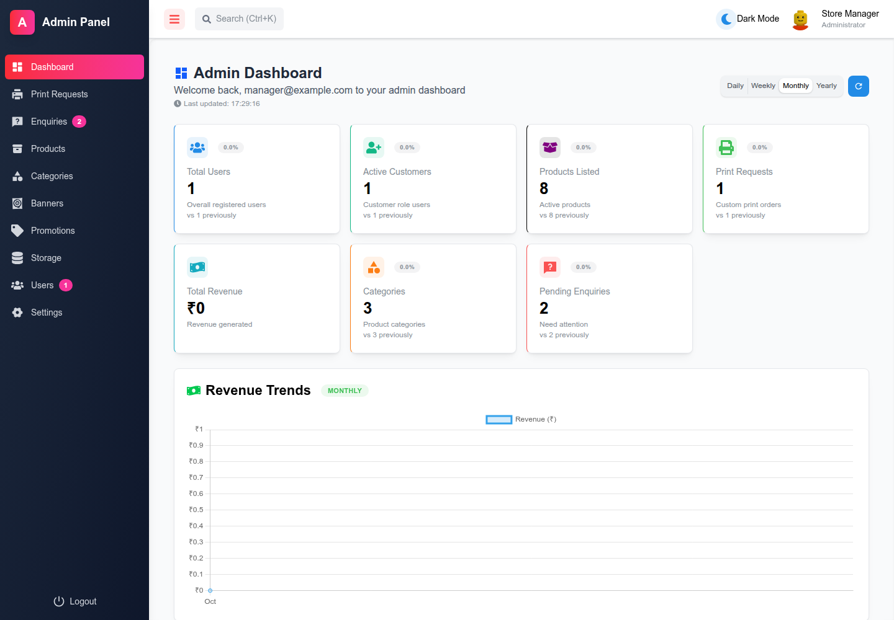

The administration application brings product maintenance and customer follow-up into one workspace. The dashboard summarises users, catalogue entries, custom printing and enquiries, with time filters and chart views. The gallery uses illustrative account and catalogue data.

| Workspace | Responsibilities |
|---|---|
| Catalogue | Add and edit products; manage categories, subcategories and groups |
| Enquiries | Review customer messages and requested items, reply and update status |
| Print requests | Review artwork specifications, quantities and request progress |
| Customer records | Inspect profile and address information needed for follow-up |
| Store presentation | Manage banners, promotional settings and supporting content |
| Reporting | Retrieve dashboard summaries through a PostgreSQL reporting function |

<table>
<tr><th width="50%">Product management</th><th width="50%">Enquiry management</th></tr>
<tr><td>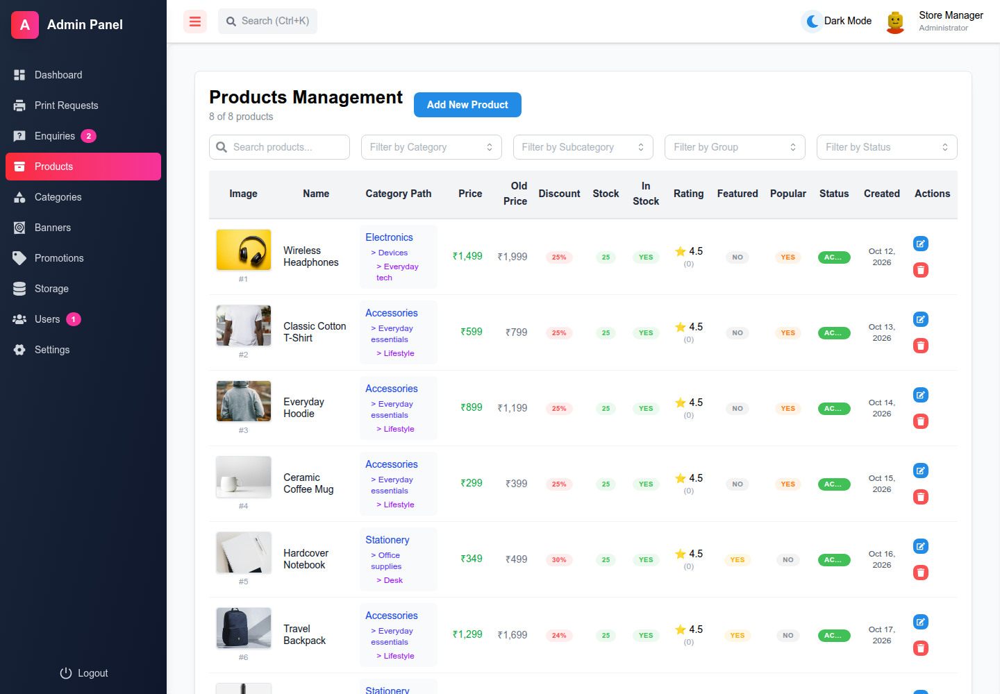</td><td>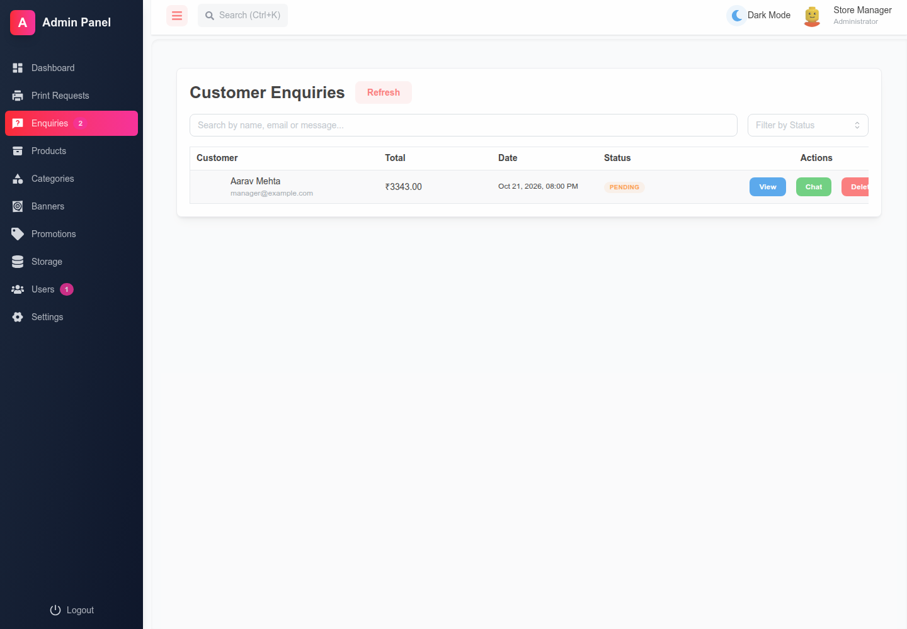</td></tr>
<tr><th>Print requests</th><th>Phone dashboard</th></tr>
<tr><td>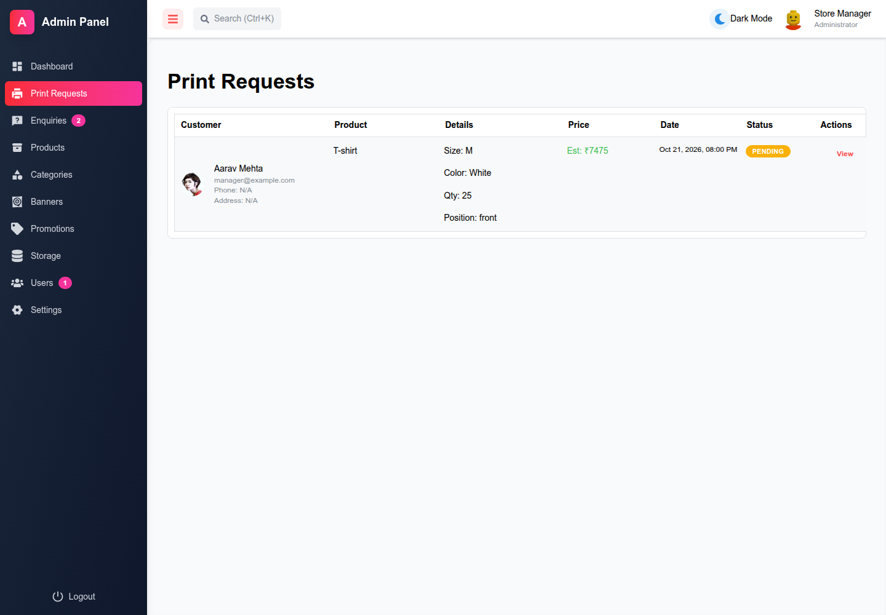</td><td>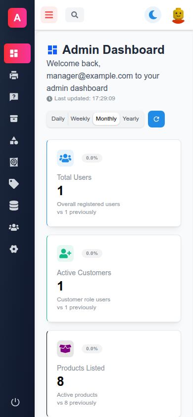</td></tr>
</table>

